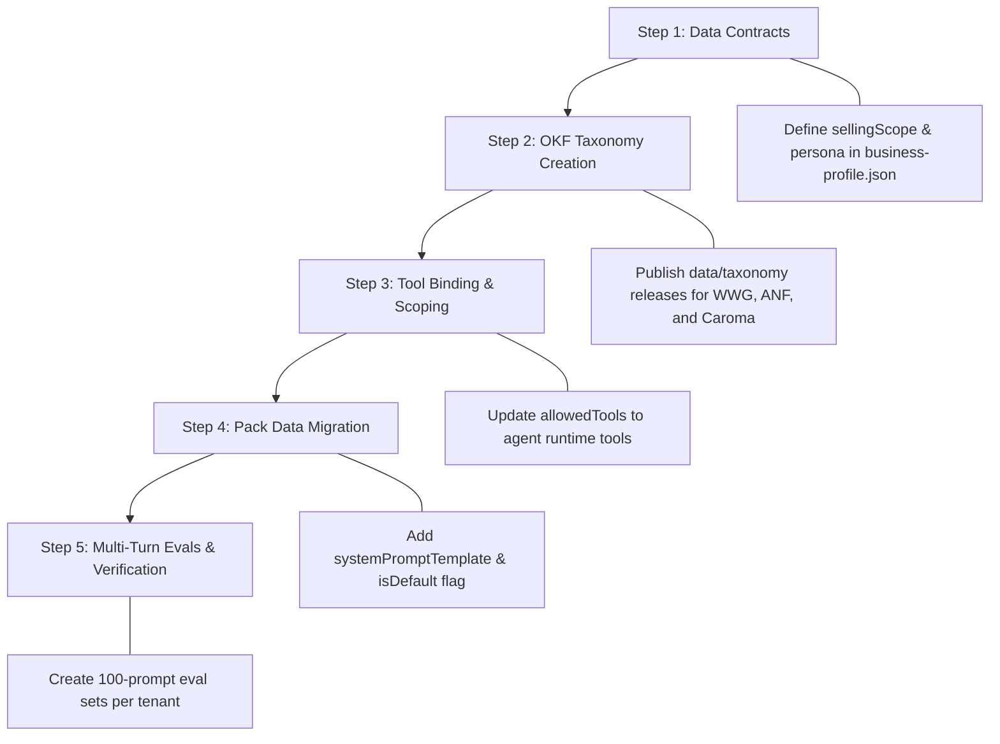

# Multi-Tenant Agent-Only Readiness Audit: Workwear Group, Abercrombie & Fitch, and Caroma

> **Document Status:** Comprehensive Readiness Assessment & Gap Analysis  
> **Target Architecture:** JourneyAX Agent-Only Mode (Autonomous Tool-Calling Loop)  
> **Audited Tenants:**  
> 1. **Workwear Group** (`packs/workweargroup/`) — Industrial Workwear, Safety Apparel & B2B Procurement  
> 2. **Abercrombie & Fitch** (`packs/abercrombie/`) — Retail Apparel, Lifestyle Fashion & B2C Cart  
> 3. **Caroma Australia** (`packs/caroma/`) — Commercial & Residential Sanitaryware, Tapware & Specification  
> **Reference Baseline:** PlaceMakers NZ (`packs/placemakers/`, `docs/agent-instructions/placemakers-draft.md`)  
> **Constraint:** Zero pack modification during this assessment. Audits existing pack data as-is.

---

## 1. Executive Summary & Readiness Scorecard

The JourneyAX platform has successfully transitioned its core execution engine to **Agent-Only Mode** (`feat/agent-only`), replacing rigid stage-based journey state machines with an autonomous multi-turn tool-calling loop. In this architecture:
- Prompts are generated strictly from declarative data (`release.profile`, `release.persona`, `release.agents[]`).
- Operating instructions are tenant-neutral and domain-agnostic.
- Tools are server-scoped to `agent.allowedTools`.
- Product discovery is driven by generic dynamic attributes (`colour`, `size`, `fit`, `treatment`, `finish`, etc.).
- Knowledge is retrieved through OKF (Open Knowledge Federation) as factual notes and hints without hardcoded strings.

While **PlaceMakers** possesses complete agent specifications, calculators, OKF taxonomy, and 100-prompt evaluation suites, the remaining three platform tenants (**Workwear Group**, **Abercrombie & Fitch**, and **Caroma**) remain configured primarily for legacy stage-based execution.

### Tenant Readiness Matrix

| Readiness Dimension | PlaceMakers (Baseline) | Workwear Group (`workweargroup`) | Abercrombie & Fitch (`abercrombie`) | Caroma Australia (`caroma`) |
| :--- | :---: | :---: | :---: | :---: |
| **Agent Definition & Routing** | 🟢 100% | 🟡 40% | 🟡 45% | 🟡 45% |
| **System Prompt Instructions** | 🟢 100% (7-Step Playbook) | 🔴 10% (Purpose only, 0 lines prompt) | 🟡 25% (1-sentence prompt) | 🟡 25% (1-sentence prompt) |
| **Runtime Tool Scoping** | 🟢 100% (`search_products`, etc.) | 🔴 20% (Legacy stage IDs) | 🔴 20% (Legacy stage IDs) | 🔴 20% (Legacy stage IDs) |
| **Business Scope & Negative Guardrails** | 🟢 100% (`inScope`/`outOfScope`) | 🔴 15% (Missing `sellingScope`) | 🔴 15% (Missing `sellingScope`) | 🔴 15% (Missing `sellingScope`) |
| **Persona & Brand Tone** | 🟢 100% (Full Kiwi Voice) | 🟡 50% (Profile tone, no persona) | 🟡 50% (Profile tone, no persona) | 🟡 50% (Profile tone, no persona) |
| **OKF Taxonomy & Relationships** | 🟢 100% (`data/taxonomy/`) | 🔴 0% (No OKF release) | 🔴 0% (No OKF release) | 🔴 0% (No OKF release) |
| **Dynamic Attribute Search** | 🟢 100% (`size`, `treatment`, `rValue`) | 🟡 30% (Feeds present, unindexed) | 🟡 30% (Feeds present, unindexed) | 🔴 10% (No local feeds) |
| **Safe Formula Calculators** | 🟢 100% (Plasterboard/Decking) | 🔴 0% (No calculators) | ⚪ N/A (B2C apparel) | 🔴 0% (No waterflow calc) |
| **Commerce / Action Handlers** | 🟢 100% (Quote & Cart) | 🟡 40% (Native stub, no B2B quote) | 🟡 50% (Native stub, cart only) | 🟡 40% (Activepieces stub) |
| **Multi-Turn Evaluation Suite** | 🟢 100% (`placemakers-100.json`) | 🔴 15% (Single-turn legacy eval) | 🔴 15% (Single-turn legacy eval) | 🔴 15% (Single-turn legacy eval) |
| **Overall Agent-Only Readiness** | **95% (Production Ready)** | **28% (High Effort Needed)** | **33% (Moderate Effort Needed)** | **26% (High Effort Needed)** |

---

## 2. Detailed Audit: Workwear Group (`workweargroup`)

### 2.1 Current Pack Inventory
- **Location:** `packs/workweargroup/`
- **Manifest:** `bp_workweargroup_v1`, version `1.0.0`
- **Industry:** Industrial Workwear, Uniforms & Safety Apparel
- **Primary Locale & Currency:** `en-AU`, `AUD`
- **Agent Count:** 1 (`packs/workweargroup/agents/advisor.json`)
- **Compliance Codes:** `AS/NZS 2210.3` (Safety Footwear), `AS/NZS 4602.1` (Hi-Vis Garments), `AS/NZS 4399` (Sun Protection)
- **Feeds:** Present in `data/workweargroup/feeds/`

### 2.2 Gaps for Agent-Only Mode

#### Gap WWG-1: Missing `systemPromptTemplate`
- **Current State:** `packs/workweargroup/agents/advisor.json` contains:
  ```json
  "purpose": "Guide tradespeople and safety procurement managers to compliant PPE bundles."
  ```
  It has **no** `systemPromptTemplate` field at all.
- **Impact:** The platform `buildAgentSystemPrompt` falls back to `Instructions:\nGuide tradespeople and safety procurement managers to compliant PPE bundles.` The model receives zero guidance on consultation structure, trade role qualification, compliance standard verification, or bundle construction.
- **Resolution Needed:** Author an authoritative trade playbook specifying qualification by trade role (electrician, carpenter, welder, site supervisor), day/night compliance, boot safety standards, and bulk trade pricing.

#### Gap WWG-2: Missing `isDefault` & Multi-Agent Routing
- **Current State:** `advisor.json` has `"agentId": "trades_advisor"`, but no `"isDefault": true` flag.
- **Impact:** While `AgentRouter` currently falls back to the first agent when only one agent is defined, adding a second specialist (e.g. corporate procurement manager) will break default routing unless `isDefault: true` or `release.defaultAgentId` is set.
- **Resolution Needed:** Set `"isDefault": true` on `trades_advisor` and introduce a secondary `procurement_manager` agent.

#### Gap WWG-3: Legacy Stage Capability Tools Instead of Agent Loop Tools
- **Current State:** `advisor.json` specifies:
  ```json
  "allowedTools": [
    "catalog.search",
    "solution.optimize",
    "pricing.validate"
  ]
  ```
- **Impact:** In Agent-Only mode, the runtime server tool scoping strictly allows tools matching `agent.allowedTools`. Tools named `catalog.search` or `solution.optimize` are legacy capability IDs. The agent loop fails to expose runtime tools:
  - `search_products` (dynamic attribute search)
  - `check_stock` (branch/warehouse inventory)
  - `consult_business_knowledge` (OKF compliance lookup)
  - `create_quote` (formal trade quote with volume discounting)
  - `get_cart` & `update_cart` (cart management)
  - `present_card` & `hand_off_to_human`
- **Resolution Needed:** Update `allowedTools` to the canonical agent tool names: `["search_products", "check_stock", "consult_business_knowledge", "create_quote", "get_cart", "update_cart", "present_card", "hand_off_to_human"]`.

#### Gap WWG-4: Missing `sellingScope` (Boundary Defense)
- **Current State:** `packs/workweargroup/business-profile.json` defines company metadata but omits `sellingScope`.
- **Impact:** The system prompt lacks negative boundaries (`What is NOT sold:`). An agent might entertain requests for heavy construction timber, consumer casual fashion, or plumbing fixtures without a clear boundary deflection.
- **Resolution Needed:** Define `inScope` (Hi-Vis apparel, flame-retardant overalls, safety boots, PPE, hard hats, eye protection) and `outOfScope` (casual streetwear, building timber, power tools, heavy machinery).

#### Gap WWG-5: Missing OKF Knowledge Graph & Safety Standards Release
- **Current State:** No OKF release exists under `data/taxonomy/workweargroup`.
- **Impact:** `consult_business_knowledge` cannot retrieve:
  - Which trades require Day/Night Hi-Vis (`AS/NZS 4602.1:2011 Class D/N`).
  - Which boots require composite-toe vs steel-toe (electrical hazard protection `EH` rating for electricians vs heavy penetration resistance for civil construction).
  - Ultraviolet Protection Factors (`UPF 50+` compliance under `AS/NZS 4399:2020`).
- **Resolution Needed:** Build an OKF taxonomy release compiling AS/NZS workwear standards and trade garment compatibility relationships.

#### Gap WWG-6: Missing Safe Formula Calculators (`calculators.json`)
- **Current State:** No `calculators.json` exists in `packs/workweargroup/`.
- **Impact:** Workwear procurement frequently involves crew allocation takeoffs (e.g. "Equip 12 road maintenance workers with 5 Hi-Vis shirts, 3 cargo pants, and 1 pair of boots each"). The agent must perform manual LLM arithmetic, risking hallucination.
- **Resolution Needed:** Define a pack-level `crew_uniform_calculator` in `packs/workweargroup/calculators.json` using the safe formula evaluator.

---

## 3. Detailed Audit: Abercrombie & Fitch (`abercrombie`)

### 3.1 Current Pack Inventory
- **Location:** `packs/abercrombie/`
- **Manifest:** `bp_abercrombie_v1`, version `1.0.0`
- **Industry:** Retail Apparel & Fashion
- **Primary Locale & Currency:** `en-US`, `USD` (also supports `CAD`, `EUR`, `GBP`)
- **Agent Count:** 1 (`packs/abercrombie/agents/cart-assistant.json`)
- **Feeds:** Present in `data/abercrombie/feeds/`

### 3.2 Gaps for Agent-Only Mode

#### Gap ANF-1: Minimal 1-Sentence `systemPromptTemplate`
- **Current State:** `packs/abercrombie/agents/cart-assistant.json` contains:
  ```json
  "systemPromptTemplate": "You are the cart and selection assistant. Guide the user through item choices and checkout."
  ```
- **Impact:** Fails to provide style consulting guidelines, sizing/fit guidance (e.g. Curve Love vs Classic Fit), fabric care recommendations, or return/exchange policy guardrails.
- **Resolution Needed:** Replace with an A&F Style Consultant playbook focusing on aesthetic matching, size/fit qualification, seasonal drops, and seamless B2C cart additions.

#### Gap ANF-2: Tool Mappings & B2C Cart Mode Enforcement
- **Current State:** `cart-assistant.json` specifies:
  ```json
  "allowedTools": [
    "catalog.search",
    "item.configure",
    "cart.update",
    "cart.checkout"
  ]
  ```
- **Impact:**
  - Tools are legacy capability IDs.
  - Runtime requires: `["search_products", "check_stock", "consult_business_knowledge", "get_cart", "update_cart", "present_card", "hand_off_to_human"]`.
  - **CRITICAL:** Abercrombie operates strictly in **Retail Cart Mode**. Under no circumstances should `create_quote` be permitted in `allowedTools`, as fashion retail does not utilize formal B2B Bill-of-Materials quotations.
- **Resolution Needed:** Update `allowedTools` to standard runtime tools, strictly excluding `create_quote`.

#### Gap ANF-3: Apparel Dynamic Attribute Schema
- **Current State:** Search queries rely on free-text strings.
- **Impact:** Does not leverage the generic dynamic catalogue attribute extraction built in Task F1 (`colour`, `size`, `fit`, `gender`, `category`).
- **Resolution Needed:** Declare dynamic attribute extraction rules in the agent prompt or pack schema:
  - `colour`: (e.g. Heather Grey, Light Wash, Washed Black, Oatmeal)
  - `fit`: (e.g. Curve Love, Ultra High Rise, Loose 90s, Relaxed, Tailored)
  - `size`: (e.g. XS to XXL, 24W to 34W, Regular / Short / Long lengths)

#### Gap ANF-4: Missing OKF Knowledge Graph (Fit, Fabrics & Care)
- **Current State:** No OKF release exists under `data/taxonomy/abercrombie`.
- **Impact:** The agent cannot provide grounded answers when customers ask:
  - "How does Curve Love fit compared to classic jeans?" (2-inch extra hip/thigh ratio).
  - "Will 100% linen shrink in a warm wash?"
  - "What tops coordinate with vegan leather pants?"
- **Resolution Needed:** Create an OKF taxonomy release covering denim fits, fabric composition/care, and return window terms.

#### Gap ANF-5: Missing `sellingScope`
- **Current State:** `business-profile.json` has brand tone and mission, but no `sellingScope`.
- **Impact:** Lack of negative guardrails (`outOfScope`: industrial PPE, construction boots, children's formalwear, sporting equipment).

---

## 4. Detailed Audit: Caroma Australia (`caroma`)

### 4.1 Current Pack Inventory
- **Location:** `packs/caroma/`
- **Manifest:** `bp_caroma_v1`, version `1.0.0`
- **Industry:** Commercial & Residential Sanitaryware, Tapware & Fixtures
- **Primary Locale & Currency:** `en-AU`, `AUD` (also supports `NZD`, `USD`)
- **Agent Count:** 1 (`packs/caroma/agents/advisor.json`)
- **Compliance Codes:** `AS 1172` (Water closet pans), `AS/NZS 3718` (Tapware), `WELS` (Water Efficiency Labelling and Standards)
- **Feeds:** No local product feed under `data/` (requires remote connector or catalog sync).

### 4.2 Gaps for Agent-Only Mode

#### Gap CAR-1: Minimal 1-Sentence `systemPromptTemplate`
- **Current State:** `packs/caroma/agents/advisor.json` contains:
  ```json
  "systemPromptTemplate": "You are the fixture specification advisor. Guide the user through options and quote finalization."
  ```
- **Impact:** Plumbers, architects, and interior designers require rigorous technical qualification:
  - Pan set-out dimensions (S-trap vs P-trap rough-in distances).
  - Water pressure ratings (minimum mains pressure for thermostatic mixers).
  - WELS star ratings and flow-rate compliance for green building certifications (Green Star, NABERS).
  - Finish consistency (matching brushed brass, matte black, or chrome across tapware, wastes, and shower rails).
- **Resolution Needed:** Author an architectural specification playbook with strict plumbing code references and rough-in compatibility checks.

#### Gap CAR-2: Legacy Stage Capability Tools Instead of Agent Loop Tools
- **Current State:** `advisor.json` specifies:
  ```json
  "allowedTools": [
    "catalog.search",
    "specification.configure",
    "quote.update",
    "quote.finalize"
  ]
  ```
- **Impact:** Does not map to runtime tools (`search_products`, `check_stock`, `consult_business_knowledge`, `create_quote`, `get_cart`, `update_cart`, `present_card`, `hand_off_to_human`).
- **Resolution Needed:** Update `allowedTools` to standard runtime tools, enabling `create_quote` (essential for architectural takeoff schedules and trade plumbing tenders).

#### Gap CAR-3: Missing Catalogue Data / Feed Synchronization
- **Current State:** Unlike `placemakers` (33,600 products), `abercrombie`, and `workweargroup`, `caroma` does not have a local feed in `data/caroma/`.
- **Impact:** Running `search_products` in standalone or local mock environments yields 0 catalogue results unless connected to a live staging API.
- **Resolution Needed:** Seed `data/caroma/feeds/fixtures-catalogue.json` containing core Caroma, Methven, Clark, and Dorf SKU collections with structured attributes (`finish`, `spaceType`, `welsRating`, `trapType`, `roughInMm`).

#### Gap CAR-4: Missing OKF Knowledge Graph (Plumbing Compatibility & Standards)
- **Current State:** No OKF release exists under `data/taxonomy/caroma`.
- **Impact:** Plumbing fixtures must adhere to strict spatial and hydraulic compatibility:
  - S-trap toilet pans require specific collar connectors for set-outs between 60mm and 200mm.
  - In-wall concealed cisterns require matching flush plates and stud-wall cavity depths (minimum 90mm framing).
  - Wall basin mixers require matching in-wall breeches and spout lengths relative to basin rim.
- **Resolution Needed:** Build an OKF taxonomy release encoding AS 1172 pan/cistern compatibility, tapware finish matching, and WELS flow standards.

#### Gap CAR-5: Missing Safe Formula Calculators (`calculators.json`)
- **Current State:** No `calculators.json` in `packs/caroma/`.
- **Impact:** Customers frequently ask for water-saving calculations (e.g. "How many litres per year will we save upgrading 40 commercial toilets from 3-star to 4.5-star WELS?").
- **Resolution Needed:** Implement a `water_savings_calculator` in `packs/caroma/calculators.json` using the safe formula evaluator.

---

## 5. Non-Invasive Proposed Agent Definitions (Ready for Implementation)

To enable seamless activation of Agent-Only mode when tenants are ready to migrate, the following declarative agent definitions are drafted below without altering active production pack files.

### 5.1 Workwear Group: Trades & Safety Advisor

```json
{
  "agentId": "workwear_trades_advisor",
  "name": "Workwear Trades & Safety Advisor",
  "isDefault": true,
  "role": "Trade and PPE safety specialist",
  "modelPolicyRef": "complex_reasoning",
  "maxTurns": 5,
  "allowedTools": [
    "search_products",
    "check_stock",
    "consult_business_knowledge",
    "create_quote",
    "get_cart",
    "update_cart",
    "present_card",
    "hand_off_to_human"
  ],
  "handoffConditions": [
    "Customer requests custom embroidery or corporate branding on orders under 20 units.",
    "Customer requests bulk contract credit terms or enterprise tenders over $10,000.",
    "Customer reports a safety equipment failure or workplace incident involving PPE."
  ],
  "systemPromptTemplate": "You are the Workwear Trades & Safety Advisor for Workwear Group Australia.\nYou equip tradespeople, contractors, and safety managers with compliant workwear, safety boots, and PPE.\n\n### Consultation Playbook\n1. Qualify the Trade & Environment: Identify trade (e.g., electrician, carpenter, road worker, welder) and workplace hazards (day/night road traffic, electrical arc flash, hot works, wet weather).\n2. Verify Safety Standards: Quote and adhere strictly to AS/NZS 2210.3 (footwear), AS/NZS 4602.1 (Hi-Vis), and AS/NZS 4399 (sun protection) from business knowledge.\n3. Search & Recommend: Use search_products with structured filters (safetyStandard, size, colour, gender). Recommend exact SKUs returned by the search tool.\n4. Complete the Safety System: Suggest essential matching PPE (gloves, eye protection, hard hats) using consult_business_knowledge.\n5. Authoritative Pricing & Quotes: Use create_quote for multi-item trade packages or update_cart for direct purchases. Never invent pricing.\n\n### Language & Tone\n- Australian English (e.g. hi-vis, boots, ute, trousers/pants).\n- Authoritative, practical, safety-first, and respectful."
}
```

### 5.2 Abercrombie & Fitch: Personal Style Consultant

```json
{
  "agentId": "abercrombie_style_advisor",
  "name": "Abercrombie Personal Style Consultant",
  "isDefault": true,
  "role": "Lifestyle fashion, fit, and wardrobe stylist",
  "modelPolicyRef": "fast_intent",
  "maxTurns": 4,
  "allowedTools": [
    "search_products",
    "check_stock",
    "consult_business_knowledge",
    "get_cart",
    "update_cart",
    "present_card",
    "hand_off_to_human"
  ],
  "handoffConditions": [
    "Customer reports a lost package, shipping delay, or billing dispute.",
    "Customer requests a refund or exchange on an existing delivered order.",
    "Customer repeatedly asks to speak with customer support."
  ],
  "systemPromptTemplate": "You are the Abercrombie & Fitch Personal Style Consultant.\nYou assist shoppers in discovering effortlessly stylish, authentic contemporary apparel and elevated essentials.\n\n### Styling Playbook\n1. Understand Occasion & Aesthetic: Clarify customer style preference, occasion (casual weekend, office capsule, date night, vacation), and silhouette goals.\n2. Guide Fit & Sizing: Explain fit differences (Curve Love, Ultra High Rise 90s, Relaxed) using consult_business_knowledge. Help users find their ideal waist and length.\n3. Search & Curate: Call search_products with specific attributes (colour, size, fit, gender, category). Present coordinated outfits with exact SKUs.\n4. Direct Cart Management: Add customer selections to cart using update_cart and present selections via present_card.\n5. Never Quote: You operate in retail cart mode. Do not offer formal trade quotes or tender estimates.\n\n### Language & Tone\n- Modern, authentic, inspiring, warm, and confident American lifestyle voice."
}
```

### 5.3 Caroma Australia: Commercial & Specification Consultant

```json
{
  "agentId": "caroma_specification_consultant",
  "name": "Caroma Specification & Architectural Consultant",
  "isDefault": true,
  "role": "Plumbing fixtures, bathroom design, and architectural specification consultant",
  "modelPolicyRef": "complex_reasoning",
  "maxTurns": 6,
  "allowedTools": [
    "search_products",
    "check_stock",
    "consult_business_knowledge",
    "create_quote",
    "get_cart",
    "update_cart",
    "present_card",
    "hand_off_to_human"
  ],
  "handoffConditions": [
    "Architect requests custom hospital/aged-care fixture engineering or AS 1428.1 compliance sign-off.",
    "Customer requests commercial project rebate contracts exceeding $25,000.",
    "Customer reports an active plumbing failure, burst water connection, or warranty defect."
  ],
  "systemPromptTemplate": "You are the Caroma Specification & Architectural Consultant.\nYou assist architects, licensed plumbers, commercial specifiers, and home renovators with premium bathroom and plumbing fixtures.\n\n### Specification Playbook\n1. Qualify Rough-in & Space: Establish installation parameters (S-trap vs P-trap pan set-out, in-wall cistern framing depth, water pressure, wall vs hob-mounted tapware).\n2. Ensure Hydraulic & Aesthetic Cohesion: Confirm matching finishes across tapware, showers, and accessories (Matte Black, Brushed Brass, Chrome). Ensure WELS water ratings meet project requirements.\n3. Search Authoritative Catalogue: Call search_products with structured filters (finish, spaceType, welsRating). Only recommend verified Caroma/Methven/Clark SKUs.\n4. Validate Compatibility: Consult business knowledge to verify pan-to-cistern compatibility and valve clearances.\n5. Authoritative Bill of Materials Quote: Call create_quote to assemble authoritative trade schedules and quotes with valid line items.\n\n### Compliance & Rules\n- Reference AS 1172, AS/NZS 3718, and WELS compliance standards.\n- Advise installation by licensed plumbers in compliance with AS/NZS 3500."
}
```

---

## 6. Migration Roadmap (Zero-Disruption Execution)

To bring these three tenants to production readiness in Agent-Only mode without breaking backwards compatibility:



1. **Step 1: Data Contracts & Boundaries (Low Risk)**
   - Add `sellingScope` (`inScope`, `outOfScope`) to `business-profile.json` for all three tenants.
   - Add optional `persona.json` for distinctive brand voices (Aussie Trade, Modern A&F Lifestyle, Architectural Elegance).
2. **Step 2: OKF Knowledge Federation Releases (Medium Risk)**
   - Author domain taxonomies in `data/taxonomy/workweargroup/`, `data/taxonomy/abercrombie/`, and `data/taxonomy/caroma/`.
   - Compile compliance standards, dimensional fit rules, and finish matching graphs into verified releases.
3. **Step 3: Runtime Tool Scoping & Capability Harmonization**
   - Update `allowedTools` in each tenant agent definition from legacy stage capability names to agent loop runtime tools.
   - Restrict `abercrombie` to cart tools (no `create_quote`).
4. **Step 4: Seed Catalogue Feeds for Caroma**
   - Provide local mock feed `data/caroma/feeds/fixtures-catalogue.json` for offline and CI testing.
5. **Step 5: Multi-Turn Evaluation Suites**
   - Create multi-turn evaluation datasets (`docs/evals/workwear-50.json`, `docs/evals/abercrombie-50.json`, `docs/evals/caroma-50.json`) to validate conversational accuracy, attribute extraction, and zero-hallucination compliance.
